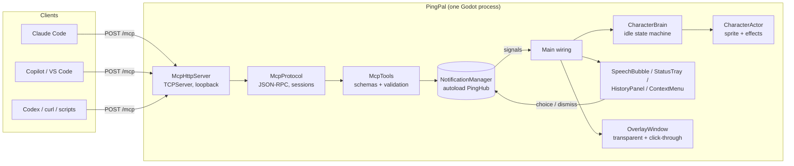
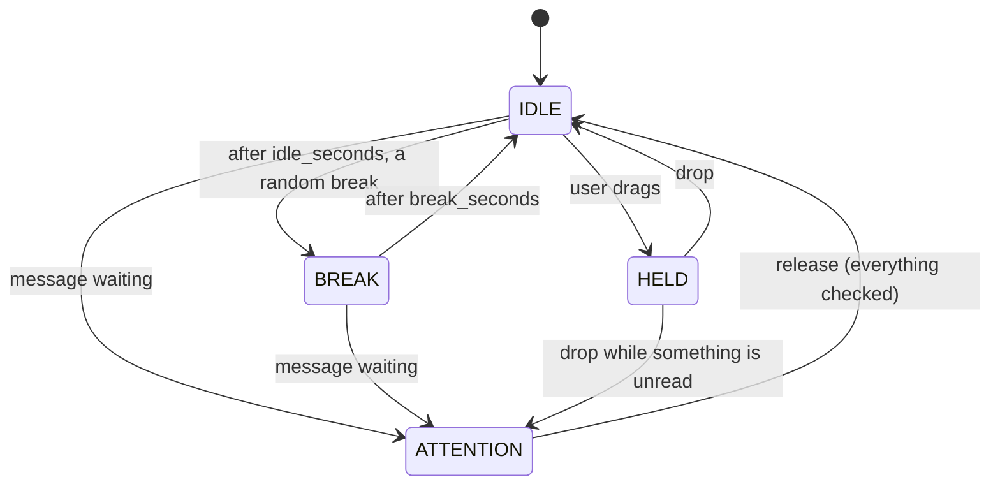

# PingPal design

## 1. What it is, and what it is not

PingPal turns "I have five AI agents running in five places" into "I glance at one character".
An embedded MCP server lets any AI client decide what the character says and does. The character is
a *notification surface with personality*, not a chat window: every interaction is short, glanceable
and skippable.

Principles

1. **The AI decides, the app arbitrates.** Clients send intent (text, status). Timing, order,
   batching and attention-grabbing are the app's job, so ten chatty agents cannot make the screen
   unusable.
2. **Nothing is lost.** Bubbles time out quickly because they are short-lived by design, but every
   notice lands in a history, and the character keeps asking for a look until you have checked.
3. **Alive when idle.** With no messages the character loops one idle animation and, now and then,
   plays a short random break. A new message always gets the same neutral attention animation:
   the character does not judge whether the news is good or bad.
4. **Swappable character.** Nothing outside the pack loader knows what the character looks like.
5. **Local and boring to install.** One Godot executable, no addons, loopback-only.

## 2. Architecture



Layering follows "signals up, calls down":

| Layer | Files | Rule |
| --- | --- | --- |
| Transport | `src/mcp/mcp_http_server.gd` | Bytes <-> HTTP requests. Knows nothing about tools. |
| Protocol | `mcp_protocol.gd`, `mcp_schema.gd` | JSON-RPC, sessions, negotiation, argument validation. No sockets. |
| Tools | `mcp_tools.gd` | Maps tool calls onto hub methods; tool schemas are the single source of truth. |
| Rules/state | `src/core/*` | Queue, priority, batching, source status, read state. **No rendering**; time only moves via `advance(dt)`, so it is deterministic in tests. |
| Character | `src/character/*` | Pack loader, brain (pure logic), actor (sprites/effects). |
| Presentation | `src/ui/*`, `src/overlay/*`, `src/main.gd` | Listens to the hub; owns no rules. |

Autoloads are deliberately few: `PingConfig` (settings) and `PingHub` (the notification manager).

## 3. The overlay window

Reused approach from Tiny Ages' `DesktopWindow` / `Skyline`:

- Borderless, `transparent`, `always_on_top`, `unfocusable` (never steals keyboard focus), with
  `per_pixel_transparency/allowed` and a transparent clear color. Renderer: GL Compatibility.
- **Strip:** the window is the full usable width x `strip_height`, docked to the bottom of the
  screen (above the taskbar via `screen_get_usable_rect`). It is the only layout: the character can
  be dragged to any spot along it, including either corner, so there is no separate corner or
  windowed mode.
- **Click-through.** `Window.mouse_passthrough_polygon` accepts *one* polygon. We compute the
  "skyline" of every interactive rectangle (character, tray, bubble/history/menu): per column, from
  the highest interactive pixel down to the lowest, run-length compressed. Disjoint areas become one
  polygon joined by a zero-height sliver on the bottom edge. A bubble is joined to the character by
  a connector rect so the tail is covered. With nothing interactive the polygon degrades to a 1px
  triangle, because an *empty* polygon would *disable* passthrough.
- On Windows the OS also clips drawing to the polygon, so everything visible must be inside it: the
  same rect list drives both.
- UI is laid out in logical pixels; `content_scale_factor` follows the screen scale and rects are
  converted to physical pixels at the edge (`OverlayWindow.build_polygon`).
- Known limits: exclusive full-screen games cover any overlay; multi-monitor placement is "current
  screen" plus a menu item to cycle.

## 4. Character packs

A pack is a folder (`res://packs/<id>/` or `user://packs/<id>/`; user wins) with `pack.json` and a
sprite sheet. The app asks for **semantic states**, never animation names.

```jsonc
{
  "schema": 2,
  "id": "pip",                       // folder-safe id
  "name": "Pip",
  "sheet": "sheet.png",
  "frame_size": [32, 32],
  "anchor": [16, 30],                // feet, in frame px (the character stands on this point)
  "behavior": {                      // all optional
    "idle_seconds": [6, 14],         // how long the idle loop runs before a break may start
    "break_seconds": [3, 6],         // how long a break lasts
    "breaks": ["sleep", "play"]      // states played at random, one at a time
  },
  "animations": {                    // name -> a run of frames on the sheet
    "idle": { "row": 0, "start": 0, "frames": 4, "fps": 3, "loop": true }
  },
  "states": {                        // semantic state -> animation (or a list of fallbacks)
    "idle": "idle", "attention": "alert", "sleep": "sleep"
  }
}
```

A character plays exactly three kinds of animation, so a pet, a person at a desk or a robot can
all be packs:

| Kind | Meaning | Shown when |
| --- | --- | --- |
| `idle` (required) | the main loop | whenever nothing else is happening; also while being dragged |
| `breaks` (optional) | short variations: a nap, a stretch, anything | picked at random, for `break_seconds`, after each `idle_seconds` |
| `attention` (required) | one neutral "look at me" | whenever a message is waiting, until the user checks it; it never says good or bad |

Break names are states: each must map (via `states`, or by sharing a name with an animation) to an
animation other than `idle`. A pack with no breaks simply idles. States the pack does not map
resolve to `idle`. Validation reports precise errors (wrong schema, animation outside the sheet,
state pointing at a missing animation, a break that maps to nothing). Frames are `AtlasTexture`s
over the sheet; the PNG can be loaded raw from `user://` so adding a character needs no editor.
2-4 frames per animation is plenty. See [PACKS.md](PACKS.md) for the contributor guide.

The default **corgi** (89x131 cells; `idle`, `sleep`, `thinking`, `happy`, `sad` used, 4 frames
each) idles, takes `sleep`/`happy`/`sad` breaks, and gets attention with its `thinking` pose. The
sheet still carries the old `walk` and `alert` rows; no pack references them. It is cut straight from
generated reference strips. `tools/art/prep_sheet.py` segments each panel (warm fur plus the dark
outline and floating Zzz/"?"), re-pixelates to a 1/8-scale grid, aligns each animation to a shared
ground line and body centre, and quantizes to one palette (`art/corgi/base_sheet.png`).
`tools/art/corgi.js` is run headless through LibreSprite by `tools/art/build.py`
(`libresprite -b --script`, the same approach Tiny Ages uses) to add small mood symbols and write
the pack's sheet; re-running reproduces identical pixels.

Because the cells are large and mostly empty above a small idle dog, `CharacterPack` records each
frame's tight visible bounds (`used_rect`) and `CharacterActor.hit_rect()` uses the *current*
frame's bounds. That keeps the click-through polygon (which on Windows also clips drawing) as small
as the picture actually is. The blue **Pip** blob remains as a second bundled pack and fallback,
generated by `tools/make_placeholder_pack.gd`.

## 5. The idle state machine

`CharacterBrain` is free of nodes and rendering; it owns position, facing and a semantic
`anim_state`. It is a chain of three animation kinds: idle, breaks, attention.



- **Idle** loops indefinitely. Each time it is (re)entered, it runs for a fresh random
  `idle_seconds` before the next break, including after a message or a drag.
- **Breaks** are picked at random from the pack's `breaks`, never the same one twice in a row when
  there is a choice, and last a random `break_seconds`.
- Messages **interrupt** whatever is playing and show the `attention` animation. It is held for as
  long as the user has something to check, not just while the bubble is up, so a message that times
  out is never missed. Status (`working`, `done`, ...) only drives the tray; it does not change the
  animation.
- **What counts as checked** (`NotificationManager.needs_attention()`): a notice that was shown stays
  *unread* until the user clicks its bubble, opens the history (click the character or a tray chip),
  or its source is cleared. A summary bubble reads every notice folded into it. Queued notices also
  keep the attention. A message that arrives while the history is open is read at once. `Main`
  re-evaluates this on `read_state_changed` and releases the character when nothing is left; after a
  drag it resumes attention if something is still unread.
- The character stays where it is; the user can drag it along the strip.

## 6. MCP server

### Transport

MCP "streamable HTTP", single endpoint `POST /mcp`, JSON responses (no SSE). Hand-written on
`TCPServer` in GDScript, ~300 lines.

Why not something else?

- *A native addon / GDExtension:* heavier to install, build per platform. Not needed; MCP's
  request/response mode needs very little HTTP.
- *A sidecar process (Node/Python/Rust) bridging to the app:* more moving parts and a second thing to
  keep running and updated. Revisit only if we need SSE, TLS or stdio.
- *stdio:* would make the *client* spawn PingPal, defeating "one persistent character". Clients that
  can only do stdio can use `mcp-remote` (see README).

Behavior and hardening:

| Concern | Handling |
| --- | --- |
| Binding | `127.0.0.1` only |
| DNS rebinding / CSRF | `Host` must be loopback; if `Origin` is present it must be loopback, else 403 |
| Auth | optional `Authorization: Bearer` token (`--token`) |
| HTTP | keep-alive, `Content-Length` and chunked bodies, `Expect: 100-continue`, requests split across packets, minimal router (`/mcp`, `/health`) |
| Limits | 16 KB headers, 1 MB bodies, 32 connections, 60 s idle timeout |
| Methods | `POST` -> JSON-RPC; notifications/responses -> `202`; `GET` -> `405` (no server-initiated stream, permitted by spec); `DELETE` ends a session |
| Protocol versions | negotiates `2025-06-18`, `2025-03-26`, `2024-11-05`; validates `MCP-Protocol-Version` |
| Batches | supported |
| Concurrency | all connections are polled from `_process`; every request is answered immediately (there is no tool that waits for the human), so no connection is ever held open |

Sessions: `initialize` returns an `Mcp-Session-Id` and records `clientInfo` (title, else name), the
negotiated protocol version and the client version. The session id is **not** an identity: who is
speaking is decided by the required `source` argument on every tool call, so **unknown or missing
session ids are tolerated** instead of `404` (the app is restarted far more often than a server
normally is, and each call carries everything it needs). Strictness can be added behind a setting if
a client needs it.

Initialize also returns **server instructions** telling the model how to behave (use `set_state`
for long tasks, keep text short, flag `needs_input` instead of waiting, always pass a stable
`source`). Tool descriptions repeat the same guidance.

### Tools

Defined once in `McpTools.definitions()` as JSON Schema; the same schema validates arguments
(`McpSchema`), and violations come back as `isError` tool results (so the model can fix itself) rather
than protocol errors. `source` is required on all three tools; a missing or blank one is rejected
before anything reaches the hub.

| Tool | Notes |
| --- | --- |
| `notify(source, text, priority?)` | queued; duplicates from the same source within 4s are dropped |
| `set_state(source, status, text?)` | updates the tray; announces `done`/`needs_input`/`error` on change |
| `clear(source)` | wipes only that source's queue, bubble and status; there is no way for one session to clear another's |

**No question tool.** An earlier `ask` tool showed buttons and blocked the model's call until the
human clicked one. It was removed: real questions usually need the session's context, the call blocked
the model for up to the client's tool timeout, and the answer was guessed at when it expired. A
session that is blocked calls `set_state(needs_input, text)` and stops; the human opens that session.
That needed no waiting, no timeouts and no held-open requests, so the whole MCP path is synchronous.

## 7. Handling many AIs

**Sources.** `SourceRegistry` maps a free-form name to a `SourceInfo`: a color derived from a hash of
the name, and a glyph (its initial). There is no grouping by app or vendor: every distinct name is its
own source, and a session picks its look by choosing its name, so "Fix login redirect" and
"Refactor billing module" get different colors and separate tray chips. Names are case-insensitive,
sanitised and capped at 80 characters (`SourceRegistry.MAX_NAME_LENGTH`, also the tool schema's
`maxLength`, so an over-long name is an error rather than being cut silently). Long names are cut with
an ellipsis in the bubble header and wrap in the history rows. The name comes from the required
`source` argument on each tool call.

**Priority queue.** `low < normal < high < urgent`, FIFO within a level.

- *high* jumps ahead of waiting items; *urgent* additionally **preempts** the current bubble (the
  interrupted one is requeued if it had barely started).
- Queue cap 24: overflow drops the lowest-priority newest notice; nothing is lost from history.

**Bubble duration.** `1.6s + 0.05s/char`, clamped 2.5-7s; x0.7 with 2+ waiting, x0.5 with 4+ (never
under 1.6s); x1.4 for urgent. A 0.4s gap between bubbles lets the character react again.

**Batching.** When 3+ low/normal `notify`/`done` notices wait, they collapse into one summary
bubble: "4 agents finished: Claude Code, Copilot, Codex" or "5 updates: ...". The individual notices
stay in the history. High/urgent items and errors are never batched.

**Status tray.** One chip per source whose status is not idle: source color + initial, state badge
(spinning ring = working, check = done, pulsing "!" = needs input, x = error). Sorted by urgency.
`done`, `error` and `needs_input` chips never fade: they wait for the user however long they were
away, and glancing (opening the history) acknowledges all three. A `working` chip has nothing to
acknowledge, so it goes stale once its session has been silent for 30 minutes (a crashed agent does
not spin forever); any call from that source, including a repeated `working`, counts as a heartbeat.

**History.** Last 100 notices, newest first, plus per-source status lines. The MCP `clear` tool never
touches it (an AI cannot erase the user's record); only the human's "Clear everything" menu item
empties it, together with the queue and chips. It asks first with an in-window "are you sure?" card
(`ConfirmCard`: Cancel / Clear everything), which cancels itself after 10 seconds.

## 8. Testing

- `tests/run_tests.gd` (headless): pack loader and validation, brain behavior (idle loop, random
  breaks, attention interrupts, drag), hub (priority, batching, dedup, preemption, durations, tray,
  read state), click-through polygon geometry, MCP protocol, the **HTTP server over real loopback
  sockets** (handshake, keep-alive, chunked, split packets, origin/host checks, bearer token) and the
  real main scene with synthetic clicks.
- `scripts/test-mcp.ps1|sh`: black-box smoke test against a running instance.
- `--screenshot` flags render the overlay with alpha to a PNG, which is how the UI was checked on a
  machine whose screen was covered by a full-screen game.

## 9. Not done yet / ideas

- Sound cues and a Do-Not-Disturb / quiet-hours setting.
- More characters; in-app pack picker.
- Tray icon / autostart; installers; macOS and Linux verification of click-through (the polygon API is
  cross-platform, but only Windows has been exercised).
- Optional stdio shim binary and HTTP `Authorization` flow for remote/tunneled use.
- Per-source mute and "focus mode" that batches everything below `high`.
- Server-initiated `notifications/*` or elicitation (SSE) if clients start relying on them.
