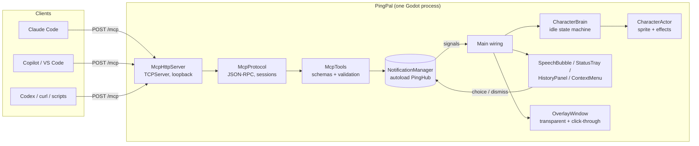
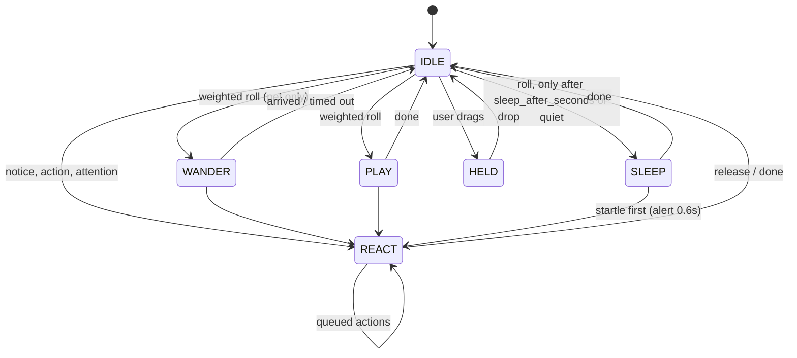

# PingPal design

## 1. What it is, and what it is not

PingPal turns "I have five AI agents running in five places" into "I glance at one character".
An embedded MCP server lets any AI client decide what the character says and does. The character is
a *notification surface with personality*, not a chat window: every interaction is short, glanceable
and skippable.

Principles

1. **The AI decides, the app arbitrates.** Clients send intent (text, mood, status). Timing, order,
   batching and attention-grabbing are the app's job, so ten chatty agents cannot make the screen
   unusable.
2. **Nothing is lost.** Bubbles time out quickly because they are short-lived by design, but every
   notice lands in a history and every unanswered question stays answerable.
3. **Alive when idle.** With no messages the character wanders, naps and plays. Idle behavior is
   also a status display: it "thinks" while agents work and gets antsy when one needs you.
4. **Swappable character.** Nothing outside the pack loader knows what the character looks like.
5. **Local and boring to install.** One Godot executable, no addons, loopback-only.

## 2. Architecture



Layering follows "signals up, calls down":

| Layer | Files | Rule |
| --- | --- | --- |
| Transport | `src/mcp/mcp_http_server.gd` | Bytes <-> HTTP requests. Knows nothing about tools. |
| Protocol | `mcp_protocol.gd`, `mcp_schema.gd` | JSON-RPC, sessions, negotiation, argument validation. No sockets. |
| Tools | `mcp_tools.gd` | Maps tool calls onto hub methods; tool schemas are the single source of truth. |
| Rules/state | `src/core/*` | Queue, priority, batching, source status, asks. **No rendering**; time only moves via `advance(dt)`, so it is deterministic in tests. |
| Character | `src/character/*` | Pack loader, brain (pure logic), actor (sprites/effects). |
| Presentation | `src/ui/*`, `src/overlay/*`, `src/main.gd` | Listens to the hub; owns no rules. |

Autoloads are deliberately few: `PingConfig` (settings) and `PingHub` (the notification manager).

## 3. The overlay window

Reused approach from Tiny Ages' `DesktopWindow` / `Skyline`:

- Borderless, `transparent`, `always_on_top`, `unfocusable` (never steals keyboard focus), with
  `per_pixel_transparency/allowed` and a transparent clear color. Renderer: GL Compatibility.
- **Strip** mode: window = full usable width x `strip_height`, docked to the bottom of the screen
  (above the taskbar via `screen_get_usable_rect`). **Corner** mode: a smaller window in the
  bottom-right. **Window** mode: ordinary decorated window for debugging.
- **Click-through.** `Window.mouse_passthrough_polygon` accepts *one* polygon. We compute the
  "skyline" of every interactive rectangle (character, tray, bubble/history/menu): per column, from
  the highest interactive pixel down to the lowest, run-length compressed. Disjoint areas become one
  polygon joined by a zero-height sliver on the bottom edge. A bubble is joined to the character by
  a connector rect so the tail is covered. With nothing interactive the polygon degrades to a 1px
  triangle, because an *empty* polygon would *disable* passthrough.
- On Windows the OS also clips drawing to the polygon, so everything visible must be inside it: the
  same rect list drives both.
- UI is laid out in logical pixels; `content_scale_factor` follows the screen scale and rects are
  converted to physical pixels at the edge (`OverlayWindow.build_polygon`).
- `wander_width` (default 900px) keeps the character near the right edge of an ultrawide strip, where
  you are looking, rather than a 3440px walk away.
- Known limits: exclusive full-screen games cover any overlay; multi-monitor placement is "current
  screen" plus a menu item to cycle.

## 4. Character packs

A pack is a folder (`res://packs/<id>/` or `user://packs/<id>/`; user wins) with `pack.json` and a
sprite sheet. The app asks for **semantic states**, never animation names.

```jsonc
{
  "schema": 1,
  "id": "pip",                       // folder-safe id
  "name": "Pip",
  "kind": "pet",                     // "pet" wanders; "avatar" stays put and emotes
  "sheet": "sheet.png",
  "frame_size": [32, 32],
  "anchor": [16, 30],                // feet, in frame px (the character stands on this point)
  "head": [16, 6],                   // where accessories sit
  "behavior": {                      // all optional; defaults depend on `kind`
    "wander": true, "speed": 22,     // px/s at scale 1
    "idle_seconds": [2, 6],
    "sleep_after_seconds": 45,       // idle time before napping is allowed
    "weights": { "idle": 3, "wander": 5, "play": 2, "sleep": 2 }
  },
  "animations": {                    // name -> a run of frames on the sheet
    "walk": { "row": 1, "start": 0, "frames": 4, "fps": 8, "loop": true }
  },
  "states": {                        // semantic state -> animation (or a list of fallbacks)
    "walk": "walk", "happy": ["happy", "idle"]
  }
}
```

Required states: `idle walk sleep happy alert thinking`. Optional: `play wave dance sad excited
error sleepy neutral`. A missing optional state falls back through `CharacterPack.FALLBACKS`
(`excited -> happy -> play -> idle`, `error -> sad -> alert -> idle`, ...), so a minimal pack still
works and a rich pack gets nicer reactions. Validation reports precise errors (wrong schema,
animation outside the sheet, state pointing at a missing animation). Frames are `AtlasTexture`s over
the sheet; the PNG can be loaded raw from `user://` so adding a character needs no editor.

*Pet vs avatar* is only a different set of default `behavior` values (avatar: `wander` off, mostly
idling and emoting). Nothing else in the app branches on it.

The placeholder **Pip** is generated by `tools/make_placeholder_pack.gd` (a procedural 32x32 blob,
10 animations x 4 frames), so the repo carries no hand-drawn art yet.

## 5. The idle state machine

`CharacterBrain` is free of nodes and rendering; it owns position, facing and a semantic
`anim_state`.



- Messages **interrupt**: a notice calls `react(state, 0)` (held until its bubble goes away). AI
  `perform` actions are *queued* behind a running reaction (max 4).
- **Ambient state** (what all AIs are collectively doing) biases the dice: `working` -> never sleeps
  or plays, idles in the *thinking* pose; `needs_input`/`error` -> no play, wanders less, periodically
  does an attention hop with alert/sad; `done` -> occasional happy hop for ~20s.
- Procedural effects (`hop`, `jump`, `spin`) are applied by the actor on top of any animation.

## 6. MCP server

### Transport

MCP "streamable HTTP", single endpoint `POST /mcp`, JSON responses (no SSE). Hand-written on
`TCPServer` in GDScript, ~300 lines.

Why not something else?

- *A native addon / GDExtension:* heavier to install, build per platform. Not needed; MCP's
  request/response mode needs very little HTTP.
- *A sidecar process (Node/Python/Rust) bridging to the app:* more moving parts and a second thing to
  keep running and updated. Revisit only if we need SSE, TLS or stdio.
- *stdio:* would make the *client* spawn PingPal, defeating "one persistent character". Clients that
  can only do stdio can use `mcp-remote` (see README).

Behavior and hardening:

| Concern | Handling |
| --- | --- |
| Binding | `127.0.0.1` only |
| DNS rebinding / CSRF | `Host` must be loopback; if `Origin` is present it must be loopback, else 403 |
| Auth | optional `Authorization: Bearer` token (`--token`) |
| HTTP | keep-alive, `Content-Length` and chunked bodies, `Expect: 100-continue`, requests split across packets, minimal router (`/mcp`, `/health`) |
| Limits | 16 KB headers, 1 MB bodies, 32 connections, 60 s idle timeout |
| Methods | `POST` -> JSON-RPC; notifications/responses -> `202`; `GET` -> `405` (no server-initiated stream, permitted by spec); `DELETE` ends a session |
| Protocol versions | negotiates `2025-06-18`, `2025-03-26`, `2024-11-05`; validates `MCP-Protocol-Version` |
| Batches | supported |
| Concurrency | all connections are polled from `_process`; a request that awaits (`ask`) just keeps its connection busy while others are served |
| Disconnects | if a client hangs up mid-`ask`, the question is withdrawn (`connection_closed` -> `cancel_asks_owned_by`) |

Sessions: `initialize` returns an `Mcp-Session-Id` and records `clientInfo` (title, else name). The
client's name becomes the default `source`. **Unknown or missing session ids are tolerated** instead
of `404`: the app is restarted far more often than a server normally is, and a pure notification
tool is better off attributing to `source` (or "Unknown") than failing. Strictness can be added
behind a setting if a client needs it.

Initialize also returns **server instructions** telling the model how to behave (use `set_state`
for long tasks, keep text short, `ask` sparingly, pass a stable `source`). Tool descriptions repeat
the same guidance.

### Tools

Defined once in `McpTools.definitions()` as JSON Schema; the same schema validates arguments
(`McpSchema`), and violations come back as `isError` tool results (so the model can fix itself) rather
than protocol errors.

| Tool | Notes |
| --- | --- |
| `notify(text, source?, mood?, priority?)` | queued; duplicates from the same source within 4s are dropped |
| `set_state(status, source?, text?)` | updates the tray; announces `done`/`needs_input`/`error` on change |
| `perform(action, source?, seconds?)` | enum comes from the brain's action table |
| `ask(question, choices?, source?, timeout_seconds?)` | holds the HTTP response open until answered/timeout; see below |
| `clear(source?, all?)` | per-source or global wipe |

`ask` semantics: the call blocks (the model waits) until the user clicks a choice or
`timeout_seconds` (default 45, 5-600) passes. The bubble shows for ~12s; if ignored it collapses to a
pending question that is still answerable from the history panel or by clicking the character,
until the timeout. Results: `{answered:true, choice, index}` or `{answered:false, reason:
"timeout"|"cancelled"|"cleared"}`. Models and clients have their own tool-call timeouts (often
~60s), so the default stays below that.

## 7. Handling many AIs

**Sources.** `SourceRegistry` maps a free-form name to a `SourceInfo`: color, glyph (initial) and an
accessory (cap, bow, antenna, halo, crown, leaf). Known families (Claude, Copilot, Codex, Gemini,
Cursor, VS Code, Terminal) get fixed looks, unknown names a stable hash-derived color and accessory,
so "Claude Code · api" and "Claude Code · web" share orange but are separate tray chips. Names are
sanitised and length-capped (they are rendered on screen).

**Priority queue.** `low < normal < high < urgent`, FIFO within a level.

- *high* jumps ahead of waiting items; *urgent* additionally **preempts** the current bubble (the
  interrupted one is requeued if it had barely started).
- Queue cap 24: overflow drops the lowest-priority oldest non-question; nothing is lost from history.

**Bubble duration.** `1.6s + 0.05s/char`, clamped 2.5-7s; x0.7 with 2+ waiting, x0.5 with 4+ (never
under 1.6s); x1.4 for urgent. A 0.4s gap between bubbles lets the character react again.

**Batching.** When 3+ low/normal `notify`/`done` notices wait, they collapse into one summary
bubble: "4 agents finished: Claude Code, Copilot, Codex" or "5 updates: ...". The individual notices
stay in the history. High/urgent items, questions and errors are never batched.

**Status tray.** One chip per source whose status is not idle: source color + initial, state badge
(spinning ring = working, check = done, pulsing "!" = needs input, x = error). Sorted by urgency.
`done` fades after 90s, `error` after 10 min, `working` goes stale after 30 min (a crashed agent does
not spin forever), `needs_input` after 60 min unless a question is pending.
Glancing (opening the history) acknowledges done/error chips; `needs_input` persists until resolved.

**History.** Last 100 notices, newest first, plus per-source status lines and any pending questions
with buttons.

**Accessory.** While a bubble from a source is up, the character wears that source's accessory.

## 8. Testing

- `tests/run_tests.gd` (headless): pack loader and fallbacks, brain behavior (wander bounds,
  sleep/startle, ambient bias, avatars never walk, drag), hub (priority, batching, dedup, preemption,
  durations, tray/ambient, asks incl. timeout/cancel), click-through polygon geometry, MCP protocol,
  the **HTTP server over real loopback sockets** (handshake, keep-alive, chunked, split packets, origin/host
  checks, bearer token, blocking `ask`, withdraw on hang-up) and the real main scene with synthetic
  clicks.
- `scripts/test-mcp.ps1|sh`: black-box smoke test against a running instance.
- `--screenshot` flags render the overlay with alpha to a PNG, which is how the UI was checked on a
  machine whose screen was covered by a full-screen game.

## 9. Not done yet / ideas

- Sound cues per mood and a Do-Not-Disturb / quiet-hours setting.
- More characters (including an "avatar" example); in-app pack picker; per-pack accessories offsets.
- Tray icon / autostart; installers; macOS and Linux verification of click-through (the polygon API is
  cross-platform, but only Windows has been exercised).
- Persisted `Mcp-Session-Id`s so client names survive restarts.
- Optional stdio shim binary and HTTP `Authorization` flow for remote/tunneled use.
- Per-source mute and "focus mode" that batches everything below `high`.
- Server-initiated `notifications/*` or elicitation (SSE) if clients start relying on them.
